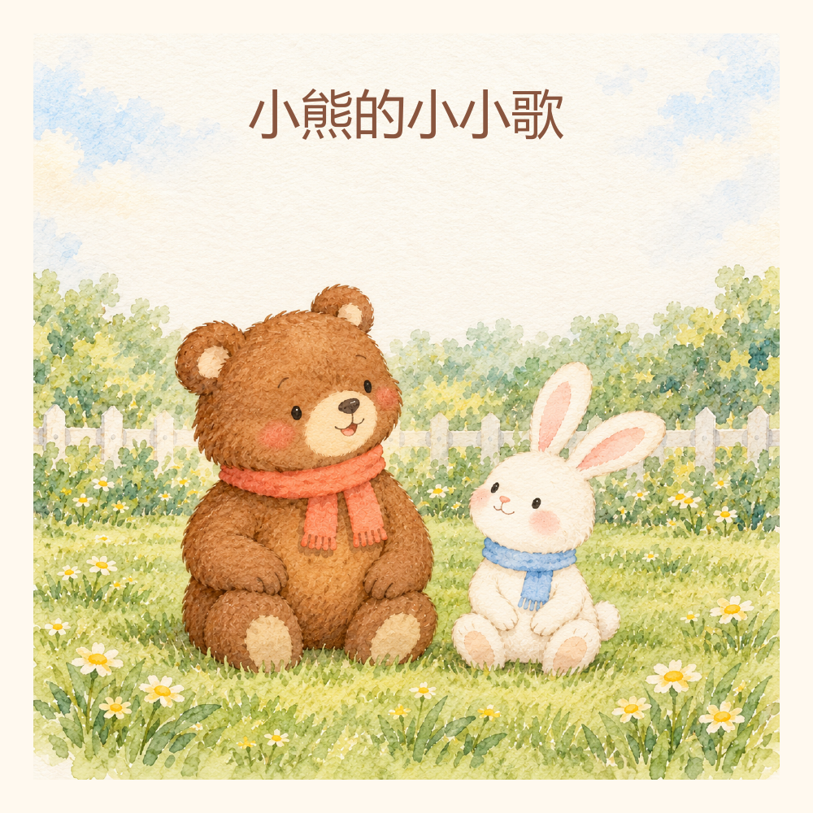
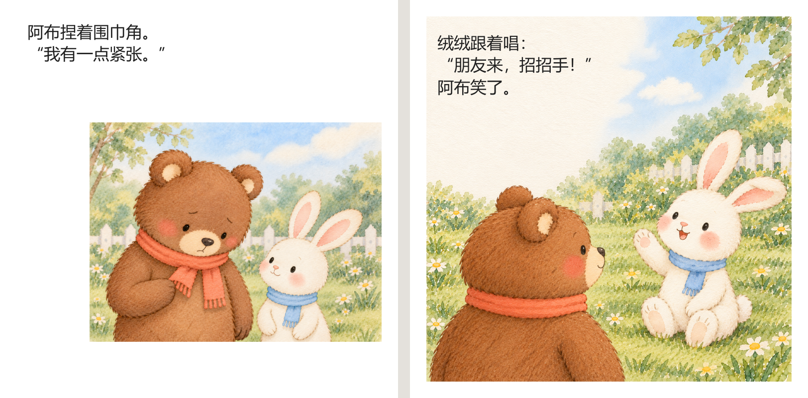
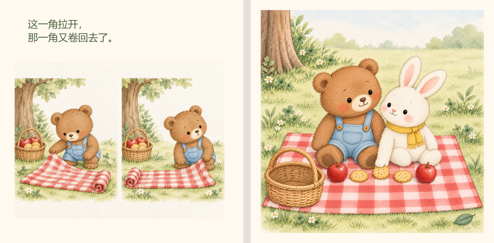

# Picturebook Studio · 绘本创作工作室

把一个故事做成可阅读、可修改的完整儿童绘本：从故事编辑、分镜和角色设定，到真实插画生成、图文排版、逐页审校与版本恢复。

这是一套独立的 Agent Skill，技能文件位于 [`skills/picturebook-studio`](skills/picturebook-studio)，也可[下载仅含技能的小包](dist/picturebook-studio.zip)。它包含中文创作流程、项目数据约定、校验器、离线 HTML／PDF 排版工具与单元测试。图像生成由使用者所在环境提供，仓库不包含图像模型或 API 密钥。

## 三本完整实例

以下三本均为原创，面向 **3—5 岁**，中文单语，**每本 10 页：封面＋8 页正文＋封底**。正文、插画、参考图、版式与验收记录保存在各自的 `book.json` 中。PDF 为 240 × 240 mm 阅读版；HTML 内嵌全部插画，下载后可以离线阅读。

### 《小熊的小小歌》

阿布想把自己编的小歌唱给朋友听，却紧张得发不出声音。拍膝、倾耳、接唱和点头把情绪变化放进画面，结尾用无字页延续两位朋友共同唱歌的快乐。



[完整 PDF](examples/brave-little-bear/delivery/book.pdf) · [离线 HTML](examples/brave-little-bear/delivery/book.html) · [可编辑项目](examples/brave-little-bear/book.json)



### 《等我的小山堆好》

团团还想用小铲子，小兔则想挖一条小河。等待中的小兔发现圆石、准备材料，最终把自己的小河连到团团的小山，让配角也拥有主动行动和自己的乐趣。


[完整 PDF](examples/sandhill/delivery/book.pdf) · [离线 HTML](examples/sandhill/delivery/book.html) · [可编辑项目](examples/sandhill/book.json)


### 《一起铺好小毯子》

豆豆与米米准备树下野餐，小毯子却一会儿卷角、一会儿被风吹起。连续小画面表现独自尝试，两位朋友的不同反应推动协作，最后通过分享饼干兑现“这里，也有你的位置”。


[完整 PDF](examples/friends-together/delivery/book.pdf) · [离线 HTML](examples/friends-together/delivery/book.html) · [可编辑项目](examples/friends-together/book.json)



在 GitHub 中点击 HTML 会看到源码；请下载文件，再用浏览器打开。预览图来自成书 PDF。示例页数、语言与水彩风格是这三本书的选择，使用技能创作新书时可以另行约定。

## 安装：复制这段提示词

适用于能够访问 GitHub、读取本地文件并支持 `SKILL.md` 技能的智能体。请把整段发送给你使用的智能体：

```text
请从公开仓库 https://github.com/zhuhanxin0308/picturebook-studio 安装 picturebook-studio 技能。

技能目录是 skills/picturebook-studio，完整下载该目录中的 SKILL.md、agents、references、scripts 和 tests；不要把 examples 安装进技能目录。

仓库中的 dist/picturebook-studio.zip 是仅含技能的安装包，解压后顶层目录为 picturebook-studio。可以优先下载这个小包；使用 Git 时只拉取技能目录，避免下载三本绘本的全部大文件。

先读取仓库 README 和技能 SKILL.md，确认内容及依赖。使用当前平台提供的技能安装器；如果没有安装器，按该平台实际支持的技能目录安装，不要猜测路径。如果已经有同名技能，先向我确认更新方式并保留可恢复的旧版本。

安装后核验 name 为 picturebook-studio、内部引用存在、脚本可读取，并说明实际安装位置和调用方式。检查是否有真实图像生成工具、Python 和中文字体：检查器及 HTML 导出使用 Python 标准库，PDF 导出另需 ReportLab 与 Pillow。缺少能力时明确说明；未经确认不要修改全局环境、索取与本技能无关的密钥或启动开发服务。

这次只安装并核验技能，不生成绘本。完成后告诉我如何开始创作。
```

Codex 用户也可以直接发送：

```text
$skill-installer 请从 https://github.com/zhuhanxin0308/picturebook-studio/tree/main/skills/picturebook-studio 安装 picturebook-studio。使用安装脚本的 --method git，只拉取技能目录，避免下载 examples 的全部大文件。已有同名技能时先确认更新方式并保留旧版。安装后读取 SKILL.md，核验引用与运行能力，并告诉我如何调用；本次不生成绘本。
```

Codex 支持用 `$skill-installer` 从其他仓库安装技能；安装后通常会自动识别，未出现时重启。不同客户端的技能目录与调用方式应以其实际环境为准。[OpenAI 官方技能文档](https://learn.chatgpt.com/docs/build-skills)

## 开始创作

安装后复制下面这段。年龄、主题、页数、语言和画风可以按需要替换：

```text
请使用 picturebook-studio，创作一本面向3—5岁、中文单语的原创绘本。

主题是“第一次尝试时有一点紧张”，主角与故事由你原创设计，采用温柔水彩。全书10页，包括封面、8页正文和封底，交付完整PDF、可编辑离线HTML、book.json、正式采用的插画及参考图。

先确认尚缺的关键要求，再写完故事与全部页计划。让图画提供正文没有直接说出的信息，让配角有自己的反应和行动，通过动作或道具兑现结尾。不要照搬已有绘本角色、情节和画面。

授权你在这些范围内自主选择分镜、构图和排版，完成代表页校准及全部实际插画；不需要逐页向我审批。逐页检查角色、肢体、接触动作、道具数量与前后状态，再排版并完整阅读成书。保留旧版本，缺少真实生成或核验能力时说明实际缺口，不用占位图替代插画，也不要只交方案或样页。
```

在 Codex 中可用 `$picturebook-studio` 显式调用；其他支持技能的客户端按其界面选择或提及技能。[调用方式](https://learn.chatgpt.com/docs/build-skills#how-chatgpt-and-codex-use-skills)

修改现有书时，可以发送：

```text
请使用 picturebook-studio 修改我提供的绘本项目。先读取 book.json 和实际插画，检查全书顺序与版本状态，再定位需要改进的文字、图画、连续性和版式。仅改排版或不影响画意的文字时复用已验收插画；动作、角色或道具变化时修订相关页面。按依赖顺序复核，导出到新版本目录，保留原书供回退。
```

## 流程与质量控制

| 阶段 | 实际完成的内容 |
| --- | --- |
| 故事与语言 | 主角愿望、阻碍、行动、转折、结尾；完整逐页正文；适龄朗读与图文分工 |
| 分镜与视觉 | 镜头节奏、翻页期待、角色设定、场景和道具基准、文字留白 |
| 插画制作 | 真实生图、真实参考图、逐页动作与数量检查、采用图摘要与输入签名 |
| 排版 | 中文及可选拼音／英文；指定文字区域、完整等比插画、无字页、窄屏图文展开 |
| 成书验收 | 全页图文复核、PDF 实际渲染、HTML 桌面与手机核验、版本状态与缺口说明 |
| 修改恢复 | 区分文字、图像与版式变化；传播前页依赖；新目录交付，保留可恢复版本 |

校验器检查数据、签名、文件摘要和验收记录；它不能自动判断画面是否好看、人物动作是否成立。市场对标先核验资料与实际阅读范围，再把可观察的方法转成自己的叙事，不把销量、阅读打卡、奖项和主观评分混为一谈。

本次技能回归运行 65 项测试，64 项通过，1 项可选浏览器测试跳过；含分支的综合覆盖率为 94%。三个示例的 HTML 已做文件与结构检查，桌面／手机实际显示仍由使用者手动核验。本仓库不分发系统字体；PDF 为屏幕阅读版本，印刷生产需另行确认尺寸、出血、色彩和装订规格。

## 项目与工具

```text
skills/picturebook-studio/
  SKILL.md                 技能入口
  agents/                  界面元数据
  references/              创作、数据约定、审校与方法来源
  scripts/                 只读校验器与HTML／PDF排版工具
  tests/                   单元测试
examples/
  brave-little-bear/        《小熊的小小歌》
  sandhill/                 《等我的小山堆好》
  friends-together/         《一起铺好小毯子》
dist/picturebook-studio.zip  仅含技能的安装包
```

排版脚本使用 Python 3.10 及以上版本。运行完整单元测试或导出 PDF 前，需要环境中已有 ReportLab 与 Pillow；缺失时请在你选定的虚拟环境中安装。在仓库根目录检查一个实例：

```sh
python skills/picturebook-studio/scripts/bookcheck.py examples/brave-little-bear/book.json --stage complete --status
python -m unittest discover -s skills/picturebook-studio/tests
```

重新导出 HTML，目标目录必须尚不存在：

```sh
python skills/picturebook-studio/scripts/render_book.py examples/brave-little-bear/book.json --output rebuilt/brave-little-bear
```

需要 PDF 时，在导出命令后增加 `--pdf --font` 和当前环境中已验证的字体路径。生图前可通过 `bookcheck.py --stage ready --font` 测量全书实际文字区域。详细参数与依赖见[排版与交付说明](skills/picturebook-studio/references/layout-and-delivery.md)，项目字段见[数据约定](skills/picturebook-studio/references/project-contract.md)。

## 方法来源

研究整合了 [picture-book-generator](https://github.com/kangqiang1996-bot/picture-book-generator)、[handraw-style](https://github.com/yang0/handraw-style)、[watercolor-diary](https://github.com/jiayuewangjavy/watercolor-diary)、[picture-skills](https://github.com/kart-io/picture-skills) 的方法，保留原作者与仓库链接。技能说明、数据约定、校验及排版代码为独立实现，没有复制上游图库、源码或整份技能文件，也不要求安装这四个项目。[来源与整合边界](skills/picturebook-studio/references/sources.md)

热门绘本的可见优点用于研究图画信息、角色行动和页面节奏；仓库没有收录参考作品的图片或正文。[编辑与对标方法](skills/picturebook-studio/references/editorial-and-benchmark.md)
